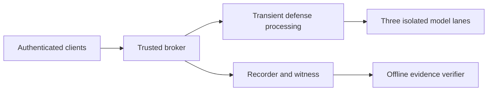

# BlindShield Arena

Prototype for the Bayora challenge: securing adversarial AI testing infrastructure.

BlindShield Arena coordinates adversarial prompts, defensive processing and local model execution while keeping authorization, result release and evidence tied to the same run. It is a bounded local prototype with documented acceptance gaps.

## Start the frontend

Use Node.js and npm:

```sh
cd frontend
npm ci
npm run dev
```

Open **http://localhost:5173**. Start in **SIMULATED DATA** mode to explore operator, red-team, blue-team and auditor workflows. Simulation does not dispatch a real model or prove backend security controls.

The new frontend includes a live HTTP adapter, lifecycle methods and evidence ZIP download support. Its integration tests use a mocked transport. Browser-to-backend mTLS integration remains unverified. Browser role headers do not authenticate a user to the backend.

## What evaluators can review

| Area | Implementation and evidence |
| --- | --- |
| Backend | Python broker, authenticated lifecycle, query budgets, encrypted artifacts and three isolated Qwen/llama.cpp lanes |
| Evidence | Recorder/witness records and a separately installed offline verifier |
| Fresh prepared-host run | Six calibration calls plus six authenticated demo calls, three-lane overlap, offline verification exit 0 and cleanup |
| Public backend test subset | 548 tests and 14 subtests passed, with one documented skip, at source `2f73df8` |
| Broader Step 6 evaluation | 35 procedures: 19 PASS, 15 PARTIAL and 1 INCONCLUSIVE |
| Frontend | React/TypeScript console, explicit simulation labels and new live adapter; current checks are in the evaluator guide |

The prepared-host result used the same laptop and native Linux/WSL environment, not independent hardware. Failed attempts remain disclosed in the validation summary. Test counts are not defense accuracy or complete acceptance.



## Evaluation packet

- [Evaluator guide and current checks](EVALUATION.md)
- [Backend setup and test subset](backend/README.md)
- [Real-model preparation and release runbook](backend/docs/PROTOTYPE-RELEASE.md)
- [Authenticated service lifecycle](backend/docs/PROTOTYPE-SERVICE.md)
- [Fresh snapshot validation summary](backend/evidence/public-snapshot-validation-20261028.json)
- [Step 6 outcomes and limitations](backend/docs/STEP6-ACCEPTANCE.md)
- [Final presentation](submission/BlindShield_Arena_Final_Submission.pptx)
- [Third-party notices](THIRD-PARTY-NOTICES.md)

## Running the real backend

A real run needs Docker, pinned model/images, an admitted prepared corpus, owner-managed authorities and fresh host/source admission. These private and large assets are absent from Git. Follow the backend runbook after provisioning them. A fresh clone is not a ready-to-run model deployment.

The API binds to loopback and requires mutual TLS. Historical public certificates and grants do not provision another host. Never disable backend authentication or commit private keys to make a demo connect.

## Current limits

Live browser integration, independent-hardware validation, isolated cache timing, general resource fairness and physical-I/O enforcement remain open. This prototype does not establish production readiness, universal model safety, host-admin rollback resistance or zero side-channel leakage.

This repo starts from reviewed sanitized history. The original working repository and its machine-specific history are separate. Model weights, corpus records, private keys, raw databases and run archives stay outside Git.

## License

Project code uses [MIT](LICENSE). The owner confirmed MIT publication permission from Mayank Joshi and Monu Kumar, including the new frontend. See [contributor permissions](CONTRIBUTOR-RIGHTS.md). Third-party material retains its own terms.
