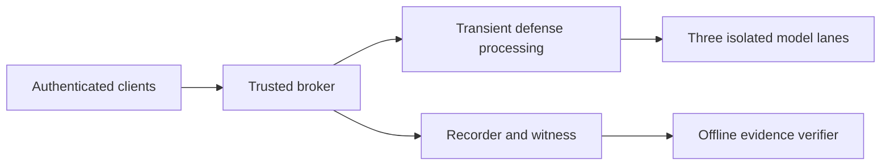

# BlindShield Arena

Prototype for the Bayora challenge: securing adversarial AI testing infrastructure.

BlindShield Arena coordinates adversarial prompts, defensive processing and local model execution while keeping authorization, result release and evidence tied to the same run. It is a bounded local prototype with documented acceptance gaps.

## Start the frontend

Use Node.js and npm:

```sh
cd frontend
npm ci
npm run dev
```

Open **http://localhost:5173**. Start in **SIMULATED DATA** mode to explore operator, red-team, blue-team and auditor workflows. Simulation does not dispatch a real model or prove backend security controls.

Live mode has a local API console connected through a loopback-only Vite mTLS proxy. A browser smoke run against a disposable Python N03 broker fixture verified operator create/seal and certificate-bound red/blue status. It made no model calls. This does not verify the separately admitted three-lane N04 service from the browser. The console uses the selected role's private client certificate; identity headers are not sent.

## What evaluators can review

| Area | Implementation and evidence |
| --- | --- |
| Backend | Python broker, authenticated lifecycle, query budgets, encrypted artifacts and three isolated Qwen/llama.cpp lanes |
| Evidence | Recorder/witness records and a separately installed offline verifier |
| Fresh prepared-host run | Six calibration calls plus six authenticated demo calls, three-lane overlap, offline verification exit 0 and cleanup |
| Public backend test subset | 548 tests and 14 subtests passed, with one documented skip, at source `2f73df8` |
| Broader Step 6 evaluation | 35 procedures: 19 PASS, 15 PARTIAL and 1 INCONCLUSIVE |
| Frontend | React/TypeScript console, explicit simulation labels and new live adapter; current checks are in the evaluator guide |

The prepared-host result used the same laptop and native Linux/WSL environment, not independent hardware. Failed attempts remain disclosed in the validation summary. Test counts are not defense accuracy or complete acceptance.



## Evaluation packet

- [Evaluator guide and current checks](EVALUATION.md)
- [Backend setup and test subset](backend/README.md)
- [Real-model preparation and release runbook](backend/docs/PROTOTYPE-RELEASE.md)
- [Authenticated service lifecycle](backend/docs/PROTOTYPE-SERVICE.md)
- [Fresh snapshot validation summary](backend/evidence/public-snapshot-validation-20261028.json)
- [Step 6 outcomes and limitations](backend/docs/STEP6-ACCEPTANCE.md)
- [Final presentation](submission/BlindShield_Arena_Final_Submission.pptx)
- [Third-party notices](THIRD-PARTY-NOTICES.md)

## Connecting the frontend to the real backend

Start the backend using the owner-managed [release runbook](backend/docs/PROTOTYPE-RELEASE.md), then launch Vite from `frontend/` with the backend's private TLS directory and actual loopback port:

```powershell
$env:BLINDSHIELD_TLS_DIR = 'C:\path\to\private-backend-output\tls'
$env:VITE_BACKEND_URL = 'https://127.0.0.1:PORT'
npm run dev
```

Replace `PORT` with the backend's reported port. The local TLS directory must hold the backend CA and role-bound client certificates/keys. These credentials stay outside Git. Vite accepts only loopback HTTPS backends and the loopback UI origin; this proxy is not a deployment gateway. Switch to **LIVE · FAIL CLOSED** to use the live API console. Live requests still have to satisfy the backend's pre-registered profile and owner-run admission.

The prototype HTTP API does not expose experiment listing, preflight, manifest/defense-artifact views, resource telemetry, or an event stream. The live console displays only supported backend responses and makes no model-activity claims unless the running admitted service returns them.

## Running the real backend

A real run needs Docker, pinned model/images, an admitted prepared corpus, owner-managed authorities and fresh host/source admission. These private and large assets are absent from Git. Follow the backend runbook after provisioning them. A fresh clone is not a ready-to-run model deployment.

The API binds to loopback and requires mutual TLS. Historical public certificates and grants do not provision another host. Never disable backend authentication or commit private keys to make a demo connect. The browser smoke result used temporary N03 control-plane credentials; it is not real-model or fresh-admission evidence.

## Current limits

Browser-to-N03 control-plane mTLS has been smoke-tested. Browser use of the admitted N04 model service, independent-hardware validation, isolated cache timing, general resource fairness and physical-I/O enforcement remain open. This prototype does not establish production readiness, universal model safety, host-admin rollback resistance or zero side-channel leakage.

This repo starts from reviewed sanitized history. The original working repository and its machine-specific history are separate. Model weights, corpus records, private keys, raw databases and run archives stay outside Git.

## License

Project code uses [MIT](LICENSE). The owner confirmed MIT publication permission from Mayank Joshi and Monu Kumar, including the new frontend. See [contributor permissions](CONTRIBUTOR-RIGHTS.md). Third-party material retains its own terms.


### Live-only video submission

The submission UI is locked to live mode, including when old browser storage requests simulation. The production client uses LiveArenaClient directly. Historical mock fixtures remain for automated tests and are not selected by the submission UI. The existing design system and navigation are retained. Values absent from the backend display NIL.

The demonstrated flow is operator create/seal, red status and blue embargo. Model output, latency, attack success, witness status and evidence verification are NIL until supplied by an admitted backend. N03 refuses model execution with POLICY_NOT_READY. Prior simulation test receipts are historical and do not validate this delivery.

For a fresh local control-plane run, prepare backend dependencies from requirements.lock and frontend dependencies with npm ci. From the repository root, set PYTHONPATH to backend/src, then run python -m arena.broker init --config backend/config/broker-demo.json --directory .local-evaluation/local-run/tls followed by python -m arena.broker serve --directory .local-evaluation/local-run/tls --port 18443. In another terminal under frontend, set BLINDSHIELD_TLS_DIR to the absolute generated tls directory and VITE_BACKEND_URL to https://127.0.0.1:18443, then run npm run dev. Credentials remain ignored locally. Do not initialize over an existing credential directory. The local operator holds all role certificates; this is a single-host demonstration.
